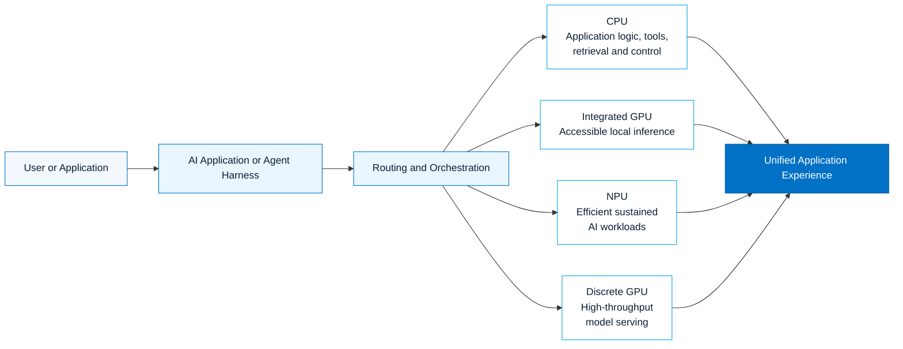
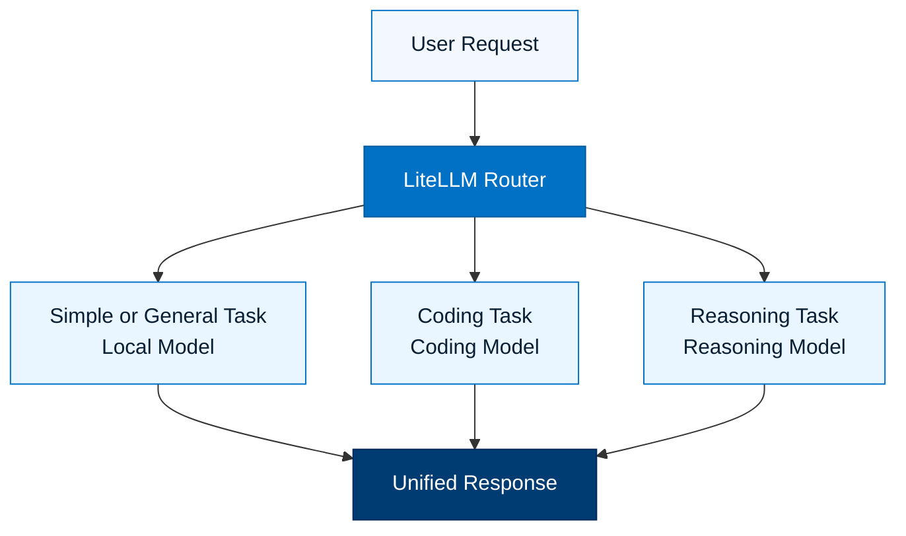
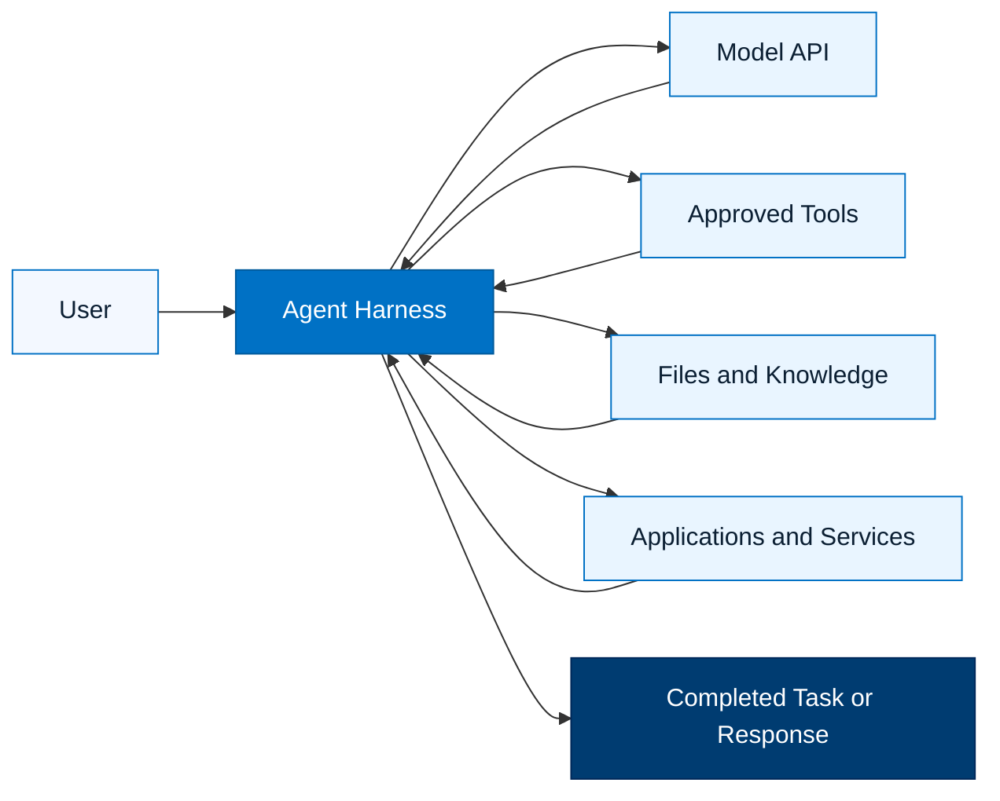
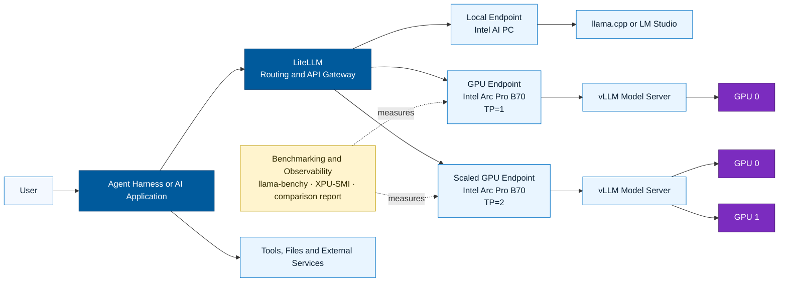

<div align="center">

# Intel SG AI Workshop 2026

### From AI PC Inference to Heterogeneous, Multi-GPU AI Deployment

Build, benchmark, scale, route, and operate AI workloads across Intel CPUs, integrated GPUs, NPUs, and discrete GPUs using open software.

[Workshop Journey](#workshop-journey) ·
[End Deployment State](#end-deployment-state) ·
[Workshop Modules](#workshop-modules) ·
[Before You Begin](#before-you-begin)

</div>

---

## What This Workshop Is About

Modern AI systems are no longer defined by a single model running on a single accelerator.

A practical AI deployment may use:

- An **Intel CPU** for application logic, orchestration, retrieval, tools, and data processing
- An **integrated Intel GPU** for accessible local inference
- An **Intel NPU** for efficient, sustained AI tasks
- One or more **Intel discrete GPUs** for higher-throughput model serving
- A routing layer that selects the appropriate model and endpoint for each request
- An agent harness that connects models to tools, memory, files, and applications

This workshop builds that system progressively.

You will begin with local inference on an Intel-powered laptop, move into hardware-aware GPU model serving, benchmark multi-GPU scaling, expose OpenAI-compatible endpoints, and connect those endpoints through an intelligent routing and agent layer.

This is a hands-on engineering workshop.

Commands are executed. Services are deployed. Performance is measured. Architectural trade-offs are observed directly.

> **The workshop journey starts with one model on one Intel AI PC and ends with a heterogeneous AI deployment spanning local inference, dedicated Intel GPUs, intelligent routing, benchmarking, telemetry, and agent execution.**

---

## The Heterogeneous AI Idea

Different AI tasks have different compute requirements.

A small local request does not always require a large remote model. A coding or reasoning task may need more compute. Retrieval, orchestration, tool execution, and model inference may also perform best on different engines.



The objective is not to force every workload onto every engine.

The objective is to place each part of the workload on the engine that best matches its performance, power, latency, capacity, and deployment requirements.

This is the foundation of heterogeneous AI.

---

## Intel Hardware and Software Layers

### Intel Heterogenous AI Software Stack


The workshop connects Intel hardware to the open AI software ecosystem used by developers and infrastructure teams.

```mermaid
flowchart LR
    APP["Applications and Agent Experiences"]

    AGENT["Agent Harnesses, APIs and Developer Tools"]

    ROUTE["Semantic Routing, Model Selection and Policy"]

    SERVE["Model Serving<br/>llama.cpp · LM Studio · vLLM"]

    FRAME["Frameworks and Model Ecosystem"]

    RUNTIME["Optimized Runtimes and Compute Interfaces<br/>SYCL · Level Zero · OpenVINO"]

    HW["Heterogeneous Intel Compute<br/>CPU · Integrated GPU · NPU · Discrete GPU"]

    APP --> AGENT
    AGENT --> ROUTE
    ROUTE --> SERVE
    SERVE --> FRAME
    FRAME --> RUNTIME
    RUNTIME --> HW

    classDef top fill:#003c71,stroke:#00285a,color:#ffffff;
    classDef app fill:#0071c5,stroke:#005a9c,color:#ffffff;
    classDef layer fill:#e9f5ff,stroke:#0071c5,color:#0b1f33;
    classDef hardware fill:#7b2cbf,stroke:#4c1d73,color:#ffffff;

    class APP top;
    class AGENT,ROUTE app;
    class SERVE,FRAME,RUNTIME layer;
    class HW hardware;
```



This layered view is important:

- Applications consume model and agent capabilities
- Agent harnesses connect models to tools and workflows
- Routing decides where a request should run
- Serving engines expose consumable model APIs
- Runtime and driver layers map workloads onto the available hardware
- Intel CPUs, GPUs, and NPUs provide the underlying compute

The workshop exposes these layers instead of hiding them behind a single application.

By the end of the workshop, you will understand how an AI request moves from an application, through a model-serving endpoint and software runtime, onto the underlying Intel hardware.

---

## Workshop Journey

The workshop follows a deliberate progression from one device to a distributed AI deployment.

```mermaid
flowchart LR
    M0["1. Prepare<br/>Environment and tools"] -->
    M1["2. Run Local AI<br/>Intel integrated GPU"] -->
    M2["3. Inspect the Stack<br/>SYCL and Level Zero"] -->
    M3["4. Scale Inference<br/>Intel Arc Pro B70"] -->
    M4["5. Benchmark<br/>TP=1 versus TP=2"] -->
    M5["6. Route Requests<br/>LiteLLM"] -->
    M6["7. Connect Agents<br/>OpenAI-compatible APIs"] -->
    M7["8. Deploy<br/>Heterogeneous AI system"]

    classDef step fill:#f3f8ff,stroke:#0071c5,color:#0b1f33;
    class M0,M1,M2,M3,M4,M5,M6,M7 step;
```



### Stage 1: Establish the Foundation

Prepare the development environment, verify the available Intel compute devices, and understand the relationship between:

- The operating system
- The Linux kernel
- Intel GPU drivers
- Level Zero
- SYCL
- Inference runtimes
- Model-serving engines
- AI applications

The objective is to establish a known working environment before adding models, routing layers, or agent frameworks.

---

### Stage 2: Run AI Locally

Run an open-weight model on an Intel-powered laptop.

This first deployment demonstrates that useful AI inference can run directly on local Intel hardware without beginning with a remote GPU server or cloud endpoint.

The local system becomes the first model endpoint in the workshop architecture.

Before proceeding, validate that:

- The model loads successfully
- The Intel GPU is detected
- The inference process uses the intended device
- The model responds through the expected interface
- The context length is appropriate for the selected model and agent harness

---

### Stage 3: Understand Hardware-Aware Inference

Inspect how the software reaches the Intel GPU through the underlying software stack.

The workshop explores the relationship between:

```text
AI Application
      ↓
Model-Serving Engine
      ↓
Inference Runtime
      ↓
SYCL / Level Zero
      ↓
Intel GPU Driver
      ↓
Intel GPU Hardware
```

This stage is important because an application displaying a successful response does not automatically prove that the intended accelerator is being used.

Participants learn to validate the complete execution path instead of assuming hardware acceleration is active.

---

### Stage 4: Move to Dedicated GPU Serving

Move from client-side inference to a dedicated Intel GPU server.

Deploy a model-serving engine on Intel Arc Pro B70 GPUs and expose the model through an OpenAI-compatible API.


This separation allows applications to consume the model as a network service instead of loading the model directly.

It also creates the foundation for multi-user access, concurrency testing, routing, observability, and multi-GPU scaling.

---

### Stage 5: Measure Multi-GPU Scaling

Compare tensor-parallel configurations using repeatable prompts, concurrency levels, throughput measurements, latency measurements, and XPU telemetry.

The objective is not simply to obtain a larger number.

The objective is to identify:

- Where throughput scales
- Where latency changes
- Where concurrency begins to saturate
- How GPU utilization behaves
- How GPU memory usage changes
- How power consumption changes
- Whether additional GPUs provide useful concurrency headroom
- Whether a serving parameter is artificially limiting the result

The workshop compares configurations such as:

```text
TP=1
One model instance distributed across one GPU path

TP=2
One model instance distributed across two GPU paths
```

Benchmark output and XPU-SMI telemetry are combined into a single comparison report.

This creates a source-of-truth view of the serving configuration, benchmark result, and observed hardware behaviour.

---

### Stage 6: Introduce Semantic Routing

Once multiple model endpoints exist, the next question is no longer only:

> How fast is the model?

The next question becomes:

> Which model should receive each request?

LiteLLM is introduced as an abstraction, gateway, and routing layer across model endpoints.



Requests can be directed according to workload characteristics such as:

- General conversation
- Coding
- Reasoning
- Model size
- Latency requirements
- Endpoint availability
- Locality
- Context-length requirements

The routing layer separates the application from the physical location of each model.

---

### Stage 7: Connect an Agent Harness

Connect the available model-serving endpoints to an agent harness.

The agent harness can use the model APIs while also interacting with approved tools, files, applications, and external services.



A model generates a response.

An agent uses model  a user request
2. Selecting a model
3. Planning the task
4. Invoking a tool
5. Reading the tool result
6. Continuing the task
7. Returning the final response

This is where model inference becomes part of an operational AI system.

---

### Stage 8: Reach the Final Deployment State

The final workshop deployment brings the previous stages together.

The completed system spans:

- Local inference
- Remote inference
- Dedicated Intel GPUs
- Multi-GPU tensor parallelism
- OpenAI-compatible model APIs
- Semantic routing
- Agent execution
- Benchmarking
- GPU telemetry
- Tools and application integration

---

## End Deployment State

At the end of the workshop, the deployment evolves from a single local model into a heterogeneous AI system.



### Control Flow

A user interacts with the agent harness or AI application.

The application sends the request to LiteLLM through an OpenAI-compatible API.

LiteLLM determines which model endpoint should process the request.

The request may be sent to:

- A local model running on an Intel AI PC
- A model running on one Intel Arc Pro B70 GPU
- A model distributed across multiple Intel Arc Pro B70 GPUs
- Another model endpoint added to the deployment

The selected serving engine processes the request and returns the result through the same API path.

### Observability Flow

While the model is being served:

- `llama-benchy` generates repeatable benchmark workloads
- The serving engine records request and token statistics
- XPU-SMI captures GPU telemetry
- The comparison parser combines the outputs
- The terminal dashboard presents the result as one comparison view

This makes the relationship between application performance and hardware behaviour visible.

### Agent Execution Flow

The model endpoint provides reasoning and language generation.

The agent harness manages the task loop and interacts with approved resources such as:

- Local files
- Documents
- Shell commands
- APIs
- Search systems
- Application connectors
- Other developer tools

The final deployment therefore separates:

- **Reasoning**
- **Routing**
- **Serving**
- **Execution**
- **Observability**
- **Hardware acceleration**

---

## What the Completed System Demonstrates

By completing the workshop, participants will have worked through:

- Local AI inference on Intel client hardware
- Intel integrated GPU detection and validation
- Hardware-aware execution through Intel GPU software layers
- OpenAI-compatible model APIs
- Dedicated Intel GPU model serving
- Tensor-parallel multi-GPU inference
- Repeatable throughput and latency benchmarking
- GPU utilization, memory, and power telemetry
- Semantic routing across model endpoints
- Agent-based access to models and tools
- A foundation that can be extended with additional models, endpoints, routing policies, and applications

The final result is not only a model demonstration.

It is a working AI deployment architecture.

---

## Workshop Modules

> Follow the modules in sequence. Each module builds on the deployment state created in the previous module.

| Module | Focus | Primary outcome |
|---|---|---|
| Module 0 | Workshop preparation | Required tools, repositories, and environment are ready |
| Module 0.5 | Local AI foundation | A local OpenAI-compatible inference endpoint is running |
| Module 1 | Intel Arc Pro B70 model serving | A model is served and benchmarked on dedicated Intel GPUs |
| Module 2 | Routing and orchestration | Multiple endpoints are available through a common routing layer |
| Module 3 | Agent integration | An agent harness can use the model APIs and approved tools |
| Final validation | End-to-end deployment | The complete heterogeneous AI flow is operational |

Use the module directories in this repository to begin each exercise.

Each module should explain:

1. The objective
2. The starting deployment state
3. The architecture change introduced by the module
4. The commands to execute
5. The expected output
6. The validation checks
7. Common failure modes
8. The resulting deployment state
9. The next module

---

## Before You Begin

### Recommended Knowledge

Participants should be comfortable with:

- Basic Linux command-line operations
- SSH access to a remote system
- Editing configuration files
- Docker or container concepts
- REST APIs and JSON
- Basic large language model terminology

Deep knowledge of GPU programming is not required.

---

### Participant Workstation

Prepare a workstation with:

- Git
- An SSH client
- Visual Studio Code or another code editor
- A modern web browser
- Access to the workshop systems
- Credentials provided by the workshop facilitator

---

### Workshop Infrastructure

Depending on the module, the workshop may use:

- An Intel Core Ultra laptop
- Intel integrated graphics
- Intel Arc Pro B70 GPUs
- A Linux GPU server
- Docker containers
- llama.cpp
- LM Studio
- vLLM
- LiteLLM
- XPU-SMI
- llama-benchy
- An agent harness supporting OpenAI-compatible endpoints

---

### Models and Context Length

Different models have different memory, context-length, and serving requirements.

Before starting a model-serving engine, confirm:

- The model architecture
- The quantization or precision
- The model file format
- The maximum supported context length
- The configured serving context length
- The available GPU memory
- The expected KV-cache requirement
- Whether the selected agent harness imposes a minimum context length

Do not assume that a model's maximum advertised context length will automatically fit within the available GPU memory.

The configured context length must fit within the memory budget of the selected serving configuration.

---

## Understanding the Benchmark Results

Hardware utilization alone does not determine whether a model-serving configuration is effective.

The workshop evaluates the deployment using multiple signals:

- **Time to first token**
- **Inter-token latency**
- **Total token throughput**
- **Per-request throughput**
- **Completed requests**
- **Concurrency**
- **GPU utilization**
- **GPU memory usage**
- **Power telemetry**
- **Scaling efficiency between TP=1 and TP=2**

The comparison report combines benchmark output and XPU-SMI telemetry into a single source-of-truth view.

This makes it possible to distinguish between:

- A configuration that is genuinely saturated
- A configuration limited by an artificial serving parameter
- A configuration with remaining concurrency headroom
- A configuration that uses more hardware without delivering proportional benefit
- A configuration that improves aggregate throughput but not single-request latency

### Why Concurrency Matters

A model server may appear underutilized when tested with only one request.

Concurrency testing progressively increases the number of simultaneous requests and reveals:

- The point at which throughput stops scaling
- The point at which latency rises sharply
- The maximum useful request concurrency
- The serving configuration's remaining headroom
- Whether TP=2 improves system capacity over TP=1

The objective is not to test the largest possible concurrency value.

The objective is to observe the curve and identify where the system begins to saturate.

---

## TP=1 and TP=2

Tensor parallelism distributes parts of a model across multiple GPUs.

### TP=1

With TP=1, the model is served using one GPU.

Potential characteristics include:

- Simpler deployment
- Lower coordination overhead
- One GPU available to the model
- Lower aggregate memory capacity
- Lower potential concurrency headroom

### TP=2

With TP=2, the model is distributed across two GPUs.

Potential characteristics include:

- Greater combined GPU memory capacity
- Additional throughput headroom
- Support for larger model or KV-cache configurations
- Communication overhead between GPUs
- Different latency and concurrency behaviour

TP=2 should not automatically be described as twice as fast as TP=1.

The actual result depends on:

- Model architecture
- Model precision
- Prompt length
- Generated token length
- Concurrency
- KV-cache configuration
- Serving-engine settings
- Inter-device communication
- Workload saturation

The benchmark module measures these effects instead of assuming the outcome.

---

## Repository Structure

The repository is organized for a sequential, README-driven workshop experience.

```text
Intel-SG-Workshop-2026/
├── README.md
├── assets/
│   ├── architecture/
│   ├── screenshots/
│   └── benchmark-results/
├── module-0/
│   └── README.md
├── module-0.5/
│   └── README.md
├── module-1/
│   ├── README.md
│   ├── scripts/
│   └── sample-output/
├── module-2/
│   └── README.md
├── module-3/
│   └── README.md
└── troubleshooting/
    └── README.md
```

The exact directory names may vary according to the final workshop module structure.

Each module is intended to be readable independently while still contributing to the complete end-to-end journey.

---

## Design Principles

This workshop follows several practical principles.

### 1. Validate One Layer at a Time

Do not introduce routing, agents, and multi-GPU serving simultaneously.

First validate the hardware.

Then validate the driver and runtime.

Then validate the serving engine.

Finally, connect the routing and application layers.

---

### 2. Observe Before Optimizing

Record the baseline before changing:

- Tensor parallelism
- Concurrency
- Context length
- GPU memory allocation
- KV-cache precision
- Batch size
- Maximum sequence count
- Serving-engine parameters

Without a baseline, it is difficult to determine whether a change helped or merely changed the bottleneck.

---

### 3. Prefer Repeatable Evidence

A repeatable benchmark and captured telemetry are more useful than a single impressive result.

Record:

- The exact model
- The serving command
- The serving configuration
- The benchmark parameters
- The prompt and generation lengths
- The concurrency
- The GPU telemetry
- The resulting throughput and latency

---

### 4. Preserve Open Interfaces

OpenAI-compatible APIs allow the model-serving layer to change without requiring the application or agent workflow to be completely redesigned.

The same application can interact with:

- A local llama.cpp endpoint
- An LM Studio endpoint
- A vLLM endpoint
- A routed LiteLLM endpoint
- Another compatible endpoint added later

---

### 5. Match the Workload to the Engine

Heterogeneous AI is not about using every engine for every request.

It is about using the most appropriate engine for each part of the system.

For example:

- CPUs may handle orchestration, tools, retrieval, and application logic
- Integrated GPUs may handle accessible local inference
- NPUs may handle efficient sustained AI workloads
- Discrete GPUs may handle larger models and higher-throughput serving

The correct placement depends on the workload and the deployment objective.

---

### 6. Keep the Deployment Observable

A successful API response proves that the application received an answer.

It does not prove:

- Which device processed the request
- Whether the GPU was saturated
- Whether memory was close to exhaustion
- Whether another serving configuration would perform better
- Whether the system can handle additional concurrent users

The workshop therefore treats telemetry and benchmarking as part of the deployment rather than as optional extras.

---

## Troubleshooting Philosophy

When something fails, isolate the layer responsible.


Avoid changing several layers at once.

Confirm each boundary before proceeding to the next one.

### Hardware Layer

Confirm that the expected Intel devices are visible to the operating system.

### Driver Layer

Confirm that the required Intel GPU driver is loaded and that the device nodes exist.

### Runtime Layer

Confirm that Level Zero, SYCL, OpenVINO, or the selected runtime can detect the intended device.

### Container Layer

Confirm that the required device paths are exposed inside the container.

### Serving Layer

Confirm that the model-serving engine starts successfully and loads the intended model.

### API Layer

Confirm that the expected endpoint responds directly before connecting LiteLLM or an agent harness.

### Application Layer

Only connect the final application after the underlying endpoint has been independently validated.

This layered troubleshooting approach reduces ambiguity and prevents an application-level error from being incorrectly attributed to the GPU.

---

## Suggested Validation Sequence

Use the following sequence whenever a new model endpoint is introduced:

```text
1. Confirm hardware visibility
2. Confirm driver and runtime visibility
3. Confirm available device memory
4. Start the model-serving engine
5. Confirm the health or models endpoint
6. Test a basic completion request
7. Test a chat-completion request
8. Validate structured tool calling if required
9. Run the baseline benchmark
10. Capture XPU-SMI telemetry
11. Increase concurrency
12. Compare the results
13. Connect the endpoint to LiteLLM
14. Connect the routed endpoint to the agent harness
15. Execute the end-to-end validation
```

This sequence keeps each validation step small and observable.

---

## Who This Workshop Is For

This workshop is designed for:

- AI developers
- Infrastructure engineers
- Solution architects
- Data scientists
- DevOps engineers
- Platform engineers
- Open-source contributors
- Technical practitioners evaluating local and private AI
- Developers exploring OpenAI-compatible model APIs
- Engineers interested in multi-GPU model serving
- Anyone who wants to understand how modern AI software reaches the underlying hardware

---

## What This Workshop Is Not

This workshop is not:

- A collection of disconnected product demonstrations
- A benchmark intended to produce only one headline number
- A promise that every workload should run on the same device
- A guide that hides the software and hardware layers
- A comparison based only on peak hardware specifications
- A production security or governance reference architecture

The workshop is an engineering journey intended to help participants build and understand a working heterogeneous AI deployment.

Production deployments require additional consideration of:

- Authentication
- Authorization
- Network segmentation
- Secrets management
- Model access controls
- Data governance
- Audit logging
- Software lifecycle management
- High availability
- Capacity planning
- Monitoring
- Incident response

---

## Extending the Workshop

The final deployment is a foundation rather than an endpoint.

Possible extensions include:

- Adding more local or remote model endpoints
- Testing additional open-weight models
- Adding embedding and reranking models
- Adding a vector database
- Introducing retrieval-augmented generation
- Comparing model quantization options
- Testing larger context lengths
- Adding request caching
- Adding fallback routing
- Adding cost-aware routing
- Adding latency-aware routing
- Adding endpoint health checks
- Adding authentication and access controls
- Adding structured logging and tracing
- Connecting additional agent tools
- Deploying the routing layer on Kubernetes
- Replacing individual components while preserving the OpenAI-compatible application interface

---

## Continue the Journey

Start with **Module 0** and follow the workshop modules in sequence.

By the end, you will not only have run a model.

You will have assembled, measured, and understood a working heterogeneous AI deployment spanning:

- Client AI
- Integrated Intel graphics
- Dedicated Intel GPUs
- Multi-GPU model serving
- OpenAI-compatible APIs
- Intelligent routing
- Benchmarking
- Telemetry
- Agent execution

> **Build locally. Scale deliberately. Measure everything. Route intelligently.**

---

## Acknowledgements

This workshop incorporates open-source technologies and community projects across model serving, inference, orchestration, benchmarking, and agent development.

The workshop materials are intended for technical learning and hands-on experimentation.

Intel, the Intel logo, Intel Core, Intel Arc, Intel Xeon, OpenVINO, and oneAPI are trademarks of Intel Corporation or its subsidiaries.

Other names and brands may be claimed as the property of others.

---

<div align="center">

### Intel SG AI Workshop 2026

**From local inference to a working heterogeneous AI deployment**

</div>
